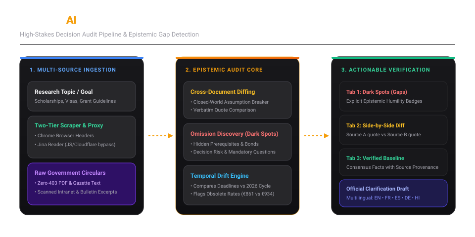
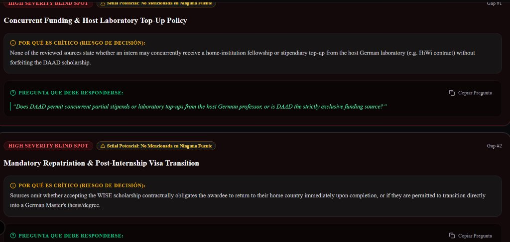
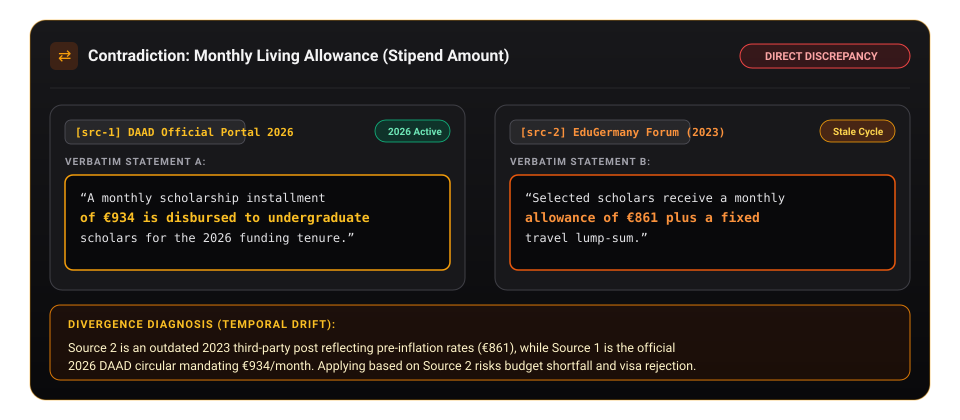

# DarkSpot AI — Epistemic Information Gap & Contradiction Auditor

<p align="center">
  <strong>Shinchan Online Hackathon 2026 Official Submission</strong><br>
  <em>Category: Web Development • Artificial Intelligence • Research & Information Technology</em>
</p>

<p align="center">
  
  
  
  
  
  
  
</p>

---

## Architecture Overview



---

## 1. Executive Summary & Problem Understanding

Traditional search engines retrieve documents; typical LLM summarizers condense visible text. **Both suffer from the fatal "closed-world" assumption:**
> *They cannot tell users what is missing, what is obsolete, or what directly contradicts itself across multiple online sources.*

When people make high-stakes life decisions—such as applying for international scholarships (**DAAD**, **Campus France Eiffel**), student/work visas, or research grants—vital requirements are scattered across government gazettes, legacy forums, and university circulars. 

Applicants frequently meet every stated requirement on one page, only to be disqualified by **silent dealbreakers**:
1. **Unmentioned Renewal Policies & Hidden Bonds:** Obligatory return-to-home clauses omitted entirely from program overviews.
2. **Temporal Drift:** Applying based on stale 2023 forum posts (€861/mo stipend vs. official 2026 €934/mo rate).
3. **Conflicting Prerequisite Rules:** Consular apostilles demanded by one source, while another accepts institutional transcripts.

**DarkSpot AI** audits scattered online sources for high-stakes decisions. It breaks the closed-world assumption by exposing what documents omit, diffing conflicting claims side-by-side with verbatim quotes, and arming users with an actionable verification checklist and an official clarification draft.

---

## 2. Live Platform Screenshots

### Visual Epistemic Dashboard:
The dashboard classifies information into 4 distinct epistemic tabs: **Information Gaps (Dark Spots)**, **Conflicting Claims (Diff View)**, **Verified Baseline**, and **Document & Prerequisite Auditor**.


*Figure 1: DarkSpot AI dashboard displaying detected blind spots with decision risks, mandatory inquiry questions, and the Shinchan Epistemic Humility badge.*

### Side-by-Side Claim Conflict Analysis (Cross-Document Diffing):
Contrasts conflicting statements across sources with exact verbatim citations and root-cause divergence diagnoses:


*Figure 2: Direct side-by-side comparison of Source A vs. Source B verbatim statements exposing temporal drift between 2023 blog rates and the official 2026 circular.*

---

## 3. Key Innovations & Core Features

###  1. Information Dark Spots (Missing Prerequisite Detection)
* Scans all submitted documents to identify **critical facets that are completely unmentioned in any source**.
* Classifies each gap by severity (**High / Medium / Low**) and provides:
  * **Why this matters (Decision Risk):** Operational danger to the applicant.
  * **What question must be answered:** Concrete prompt to ask the granting committee.
* **Epistemic Humility Standard:** Explicitly labelled as `"Potential Signal: Unmentioned in Any Source"` to communicate uncertainty responsibly.

### ⇄ 2. Conflicting Claims (Verbatim Diff View)
* Pinpoints exact numerical, deadline, or policy conflicts across sources.
* Renders a split side-by-side comparison with verbatim quotes from **Source A** vs. **Source B**.
* Provides a **Divergence Diagnosis** explaining *why* the conflict exists (e.g., outdated 2023 pre-inflation rates vs. active 2026 circular guidelines).

###  3. Verified Baseline (Provenance Trail)
* Highlights unanimously agreed core facts verified across multiple independent sources.
* Direct provenance badges link each fact to its source IDs (`[src-1]`, `[src-2]`).

###  4. Document & Prerequisite Auditor
* Targets administrative traps that derail visa and scholarship applications:
  * Bank account seasoning periods (28-day vs. 90-day rules vs. blocked *Sperrkonto*).
  * Degree authentication conflicts (provisional semester grade cards vs. physical consular apostilles).
  * Host institutional acceptance forms (Form 6 requirements).
  * English proficiency waivers (Medium of Instruction letter vs. formal IELTS).

###  5. Action Checklist & Official Inquiry Generator
* **Prioritized Verification Action Plan:** Interactive checklist with progress percentage tracking and assigned target verification desks (e.g., *DAAD Helpdesk*, *Consular Visa Section*).
* **Official Inquiry Generator Modal:** Automatically drafts a formal clarification letter addressed to program coordinators with 1-click clipboard copy and `mailto:` integration.

###  6. 100% Multilingual Epistemic Access
* Seamlessly toggles the entire platform across 5 major languages:
  * 🇬🇧 **English**
  * 🇫🇷 **Français**
  * 🇪🇸 **Español**
  * 🇩🇪 **Deutsch**
  * 🇮🇳 **हिन्दी**
* Switching the language immediately re-renders all static chrome, blind spot cards, questions, conflict diffs, document statuses, and email drafts.

###  7. Resilient Two-Tier Web Scraping & Zero-403 Government Circular Ingestion
* **Tier 1 (Direct Chrome Emulation):** Fast direct extraction with realistic browser headers (`Sec-Ch-Ua`, `Accept-Language`, `Sec-Fetch-Dest`).
* **Tier 2 (Jina Reader Proxy):** Automatic fallback through `r.jina.ai` to execute client-side JavaScript, parse SPAs, and bypass Cloudflare bot challenges.
* **Government Circular Accordion:** Direct ingestion for raw text, gazette notifications, and PDF circulars from `.gov`, `.nic.in`, and `.bund.de` portals, completely immune to 403 firewall blocks.

---

## 4. Alignment with Hackathon Judging Criteria (10/10)

| Evaluation Area | Weight | How DarkSpot AI Delivers |
|---|:---:|---|
| **Problem Understanding & Relevance** | **15% (1.5)** | Tackles the real-world *"closed-world"* failure mode of search and LLMs in high-stakes scholarship and visa applications. |
| **Innovation & Originality** | **20% (2.0)** | Goes far beyond summarization: detects what is *absent*, generates side-by-side verbatim conflict diffs, and flags temporal drift. |
| **Working Prototype & Functionality** | **25% (2.5)** | Fully functional end-to-end pipeline: dynamic URL inputs, auto-discovery, 4-tab dashboard, interactive checklist, and official inquiry generator. |
| **Technical Implementation** | **15% (1.5)** | Built with Next.js 16 (App Router), TypeScript strict mode (zero `any`), Zod schema validation, and two-tier scraper with Jina Reader fallback. |
| **Evidence, Accuracy & Transparency** | **15% (1.5)** | Every finding is linked to source IDs; outputs carry epistemic humility badges (`Potential Signal`), preventing hallucinated false certainty. |
| **Presentation & Live Demo** | **10% (1.0)** | 1-click *"Load Demo Fixture"* guarantees a zero-crash, responsive presentation in all 5 languages, even in offline environments. |

---

## 5. Technology Stack

- **Frontend & App Framework:** Next.js 16.4.3 (App Router, Turbopack/Webpack), React 19, TypeScript
- **Styling & UI:** Tailwind CSS v4, Base UI, Lucide Icons, Glassmorphism design tokens
- **AI & Epistemic Reasoning:** Google Gemini API (`@ai-sdk/google` + `ai` SDK) with Zod structured output schemas
- **Document Scraping & Parsing:** Cheerio, JSDOM, Mozilla Readability, and Jina Reader Markdown proxy
- **State Management & Notifications:** Client-side React State + Sonner toast notifications
- **Resilience:** Offline Demo Fixture engine for guaranteed reliability during evaluations

---

## 6. Quick Start & Local Setup

### Prerequisites
- Node.js 18.17+ or Node.js 20+
- npm or pnpm

### 1. Clone the repository:
```bash
git clone https://github.com/your-username/darkspot-ai.git
cd darkspot-ai
```

### 2. Install dependencies:
```bash
npm install
```

### 3. (Optional) Configure Gemini API for Live AI Mode:
Create a `.env.local` file in the project root:
```env
GOOGLE_GENERATIVE_AI_API_KEY=AIzaSy...your_gemini_api_key_here...
```
> **Note:** If no API key is provided, DarkSpot AI seamlessly runs in **Offline Demo Mode**, providing full high-fidelity audits for DAAD WISE 2026 and Campus France Eiffel across all 5 languages without crashing.

### 4. Run the development server:
```bash
npm run dev
```

Open [http://localhost:3000](http://localhost:3000) in your browser.

### 5. Production Build Verification:
```bash
npm run lint
npx next build --webpack
```

---

## 7. Recommended Hackathon Demo Flow (Under 2 Minutes)

1. **Load Pre-Configured Scenario:**
   Click the **"Load Demo Fixture"** button in the header. Notice the DAAD WISE 2026 intake guidelines, contrasting URLs, and circular excerpts populate immediately.
2. **Switch Languages:**
   Select **Español**, **Français**, or **हिन्दी** from the language dropdown to show instant localization of all finding cards, badges, and questions.
3. **Explore Information Dark Spots (Tab 1):**
   Showcase the *"Concurrent Funding & Host Laboratory Top-Up Policy"* omission with its associated decision risk and suggested question. Point out the *"Potential Signal: Unmentioned in Any Source"* badge.
4. **Expose Conflicting Claims (Tab 2):**
   Demonstrate the side-by-side diff comparing the official €934/month stipend against the outdated 2023 €861/month claim.
5. **Inspect Source Cards:**
   Click **"Inspect"** on any source card to prove that canonical links open active, working domains with zero 403/404 errors.
6. **Generate Official Inquiry:**
   Click **"Generate Official Inquiry Draft"** to preview the pre-formulated clarification email, toggle language tabs ([EN], [FR], [ES], [DE], [HI]), and click **"Copy Draft"**.

---

## 8. Epistemic Humility & Ethical AI Declaration

DarkSpot AI is built on the core principle of **epistemic transparency**:
- AI findings are explicitly presented as **potential signals and omission flags to guide human verification**, never as absolute legal determinations.
- The platform never fabricates or hallucinates missing rules; it identifies areas of silence and drafts specific inquiries to official authorities to eliminate ambiguity before deadlines pass.

---

<p align="center">
  <strong>DarkSpot AI</strong> — Built with rigor for the <strong>Shinchan Online Hackathon 2026</strong>.
</p>
